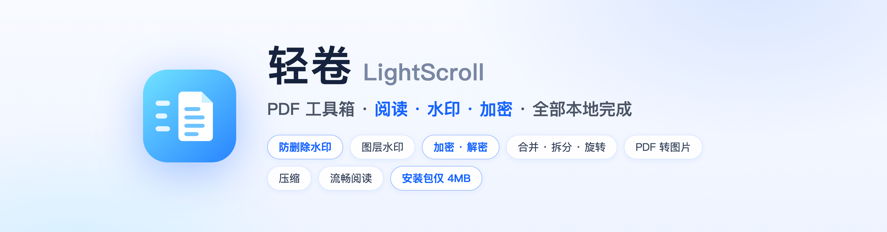
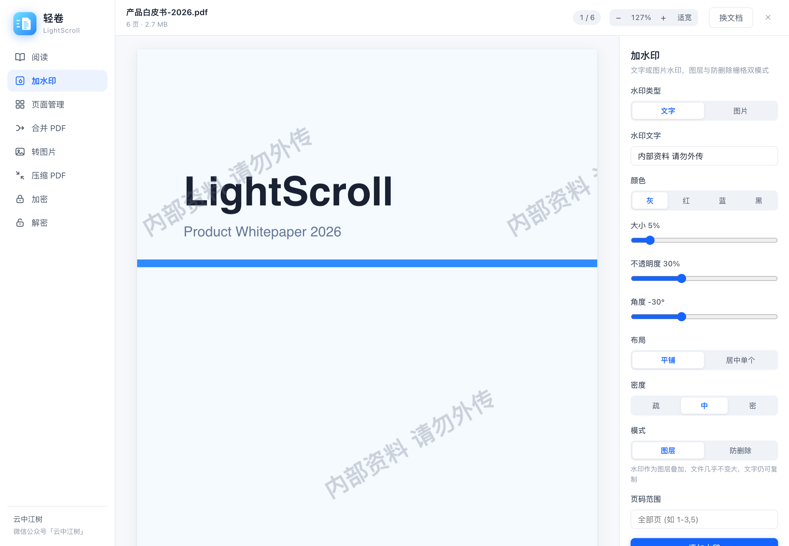
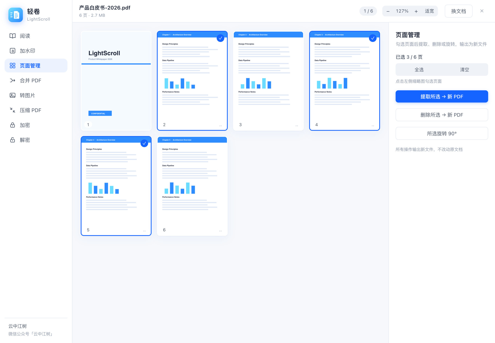
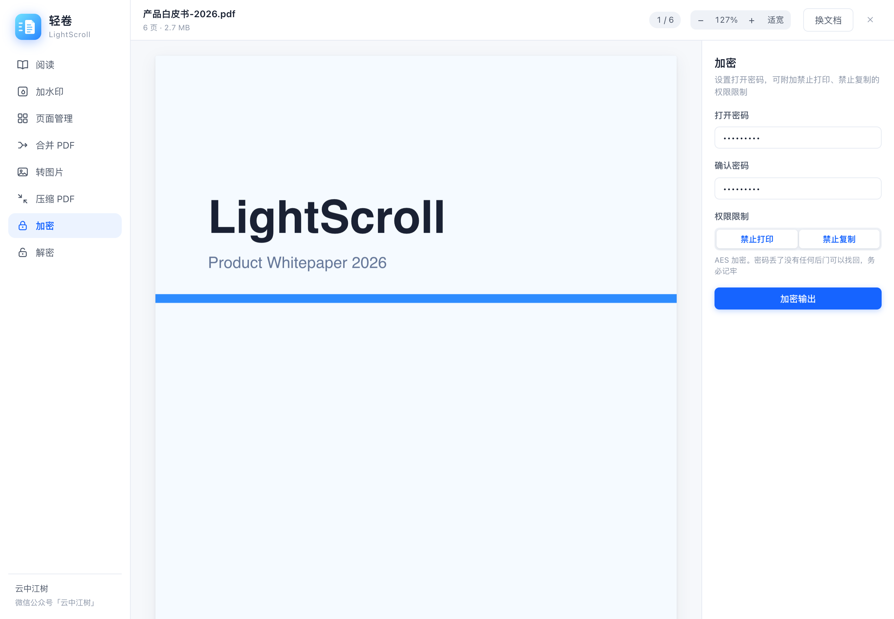
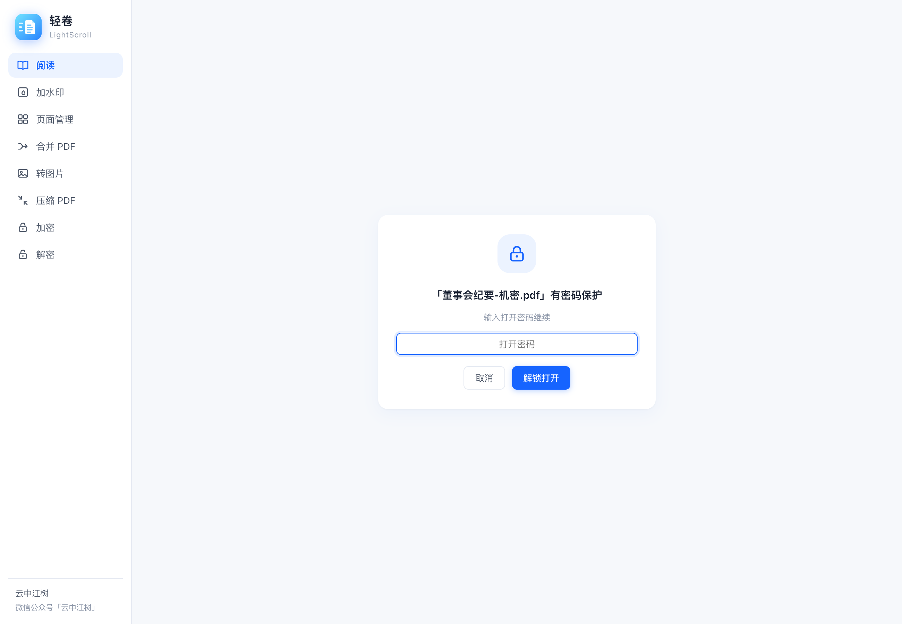
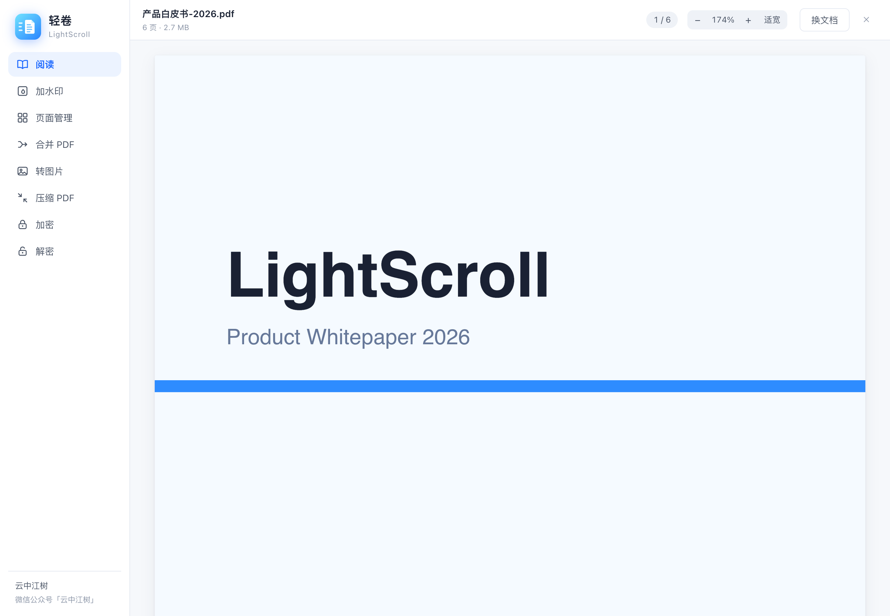

<div align="center">



**PDF 工具箱 · 阅读 · 水印 · 加密 —— 全部本地完成**

流畅阅读、双模式水印（图层 / **防删除栅格**）、AES 加密解密、合并拆分旋转、转图片、压缩。
没有服务器、没有上传、没有会员——你的文档永远不离开你的电脑，安装包只有 **4MB**。

[](../../releases)
[](https://v2.tauri.app/)
[](https://vuejs.org/)
[](LICENSE)
[](../../releases)

[下载安装](../../releases) · [功能一览](#八个工具) · [从源码构建](#从源码构建) · [常见问题](#常见问题)

</div>

---

在线 PDF 工具要你上传文件，桌面商业软件要你按年付费。可是加个水印、合并几页、设个密码，本来就该是**拖进来、点一下**的事。

**轻卷把常用的 PDF 操作做成了一个 4MB 的本地应用。** 打开即用，处理不出网，输出永不覆盖原文件。

## 界面预览

**加水印**——改参数时页面上实时预览效果，所见即所得：



**两种水印模式是轻卷的灵魂**：

| 模式 | 原理 | 适合 |
|------|------|------|
| **图层水印** | 水印作为图层叠加，文件几乎不变大，文字仍可选中复制 | 品牌标识、内部标记 |
| **防删除水印** | 整页栅格化，水印融进像素**无法被任何工具移除** | 合同、证件、简历外发 |

**页面管理**——缩略图勾选，提取 / 删除 / 旋转，输出新文件不动原件：



**加密与解密**——AES 加密、权限限制（禁止打印 / 复制）；打开加密文档时优雅的密码解锁：





**流畅阅读**——连续滚动、懒加载渲染、缩放适宽，大文档不卡：



## 八个工具

- 📖 **阅读** — 连续滚动 + 懒加载 + 缩放，加密文档输密码直接读
- 💧 **加水印** — 文字/图片 × 图层/防删除，透明度/角度/平铺密度/页码范围全可调，实时预览
- 🗂 **页面管理** — 缩略图勾选 → 提取 / 删除 / 旋转 90°
- 🔗 **合并 PDF** — 多文件排序合并，不用先打开任何文档
- 🖼 **转图片** — PNG/JPG，150/200/300 DPI，按页码编号
- 🗜 **压缩 PDF** — 整页栅格化重建，扫描件大幅瘦身，前后体积对比
- 🔒 **加密** — AES 打开密码 + 禁止打印/复制权限
- 🔓 **解密** — 已知密码，一键输出无密码副本

通用能力：输出**永不覆盖**原文件 · 页码范围支持 `1-3,5` 语法（含中文逗号）· 扫描件旋转页水印方向自动修正。

## 下载使用

前往 [Releases](../../releases) 下载对应平台安装包（macOS `.dmg` / Windows `.exe` / Linux `.AppImage` `.deb`）。macOS 版已签名并通过 Apple 公证。

## 从源码构建

依赖：[Rust](https://rustup.rs/) stable、Node.js 18+

```bash
git clone https://github.com/yzfly/lightscroll.git && cd lightscroll
npm install && npm install --prefix frontend
npm run dev     # 开发调试
npm run build   # 构建安装包
```

没有任何外置二进制依赖——PDF 渲染用 [pdf.js](https://mozilla.github.io/pdf.js/)（Firefox 的引擎），重组与加密用 [@cantoo/pdf-lib](https://github.com/cantoo-scribe/pdf-lib)，全部跑在 WebView 里。

## 技术架构

```
frontend/src/pdfops.js   PDF 操作核心 (渲染/水印/页面操作/加解密)
frontend/src/App.vue     阅读器 + 工具面板
src-tauri/               Tauri 外壳, 仅 3 个 Rust 命令 (输出路径/文件大小/定位文件)
docs/                    README 素材, 截图 demo 模式 (?demo=<tool>)
```

文字水印用 canvas 以系统字体（苹方/雅黑）渲染成贴图——中文零乱码，且不用往应用里塞 10MB 字体文件。

## 常见问题

**防删除水印真的无法移除吗？**
是。整页内容和水印被重新渲染成一张像素图，水印不再是独立对象，任何"去水印"工具都无从下手。代价是文字不可再选中、文件会变大——这是物理规律，不是缺陷。

**密码忘了能解开吗？**
不能。AES 加密没有后门，轻卷也不会偷偷保存你的密码。设置密码前请务必记牢。

**压缩后文字选不中了？**
「压缩 PDF」是栅格化压缩，最适合扫描件。文字型 PDF 若需保留可选文字，暂不建议压缩。

**和轻影是什么关系？**
同属「轻」系列：[轻影 LightVideo](https://github.com/yzfly/lightvideo) 管视频（压缩/转码/AI 字幕），轻卷管 PDF。同样的设计语言，同样的本地优先。

## 许可

[MIT](LICENSE)。内置 pdf.js（Apache-2.0）与 @cantoo/pdf-lib（MIT）。

## 作者

**云中江树** · 微信公众号「云中江树」

如果轻卷帮你省了一次"上传到在线工具"的犹豫，点个 Star ⭐ 就是最好的鼓励。
